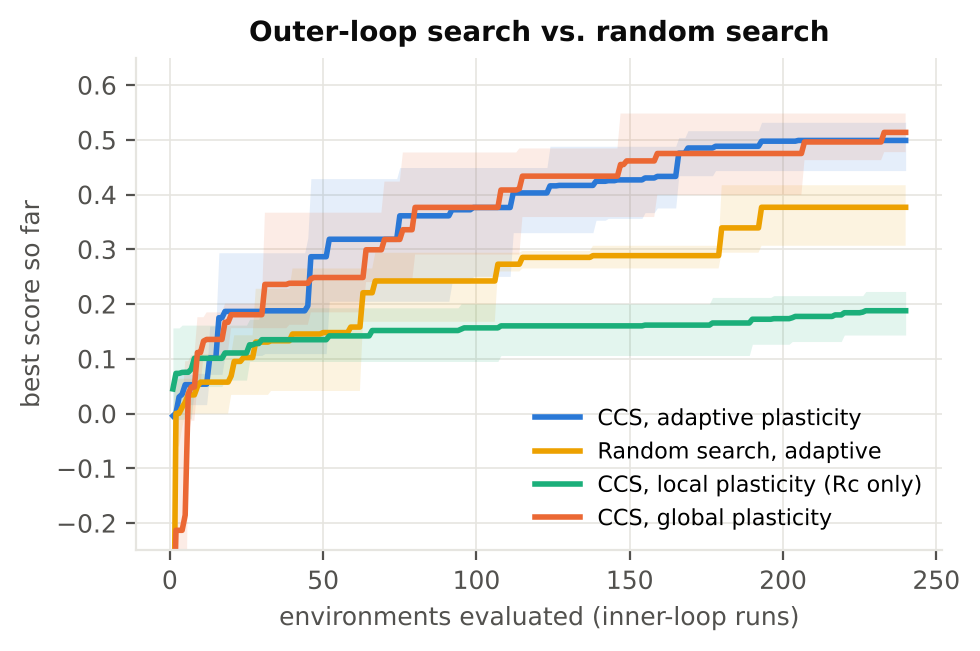
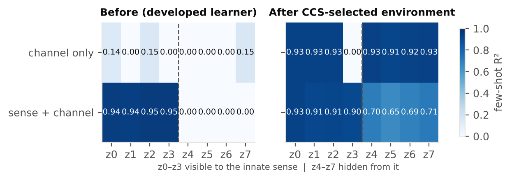

# Cognitive Capability Search (CCS)

> **What can this learner become?**

Reading is a strange ability. Evolution never designed the brain to read, yet culture found an input
system the brain learns so well it becomes automatic. How many other learnable abilities sit inside a
learner's constraints, undiscovered because nobody built the right interface or training environment?

**CCS turns that question into a search.** An inner loop trains a fixed-architecture learner. An outer
loop searches over *interfaces, objectives, input conditions and plasticity schedules*, scored by:

```
score(e) = capability gain  -  β · interference  -  γ · training cost
```

and **no term names a target capability.** Capability gain is how much more of the world's latent
structure becomes cheaply (few-shot) readable from the learner's internal representation. Interference
is damage to the abilities it already had. A held-out task battery the search never sees checks whether
what was found is actually useful.

📄 **Paper:** [`paper/paper.pdf`](paper/paper.pdf): *Searching the Cognitive Possibility Space: A
Computational Framework for Discovering Learnable Capabilities*

---

## The toy

| | |
|---|---|
| **World** | 8 latent causes `z`. The learner's innate sense sees only `z0..z3`; `z4..z7` are hidden from it. |
| **Learner** | Modular tanh network: sensory region `R1`, interface region `Rc`, association region `R2`, innate readout `R3`. "Develops" on the innate task with the new channel silent. The channel→association pathway starts weak, below the noise floor. |
| **Environment genome** | which latents a new channel carries · its code (`linear`, `population`, `phase`, `hashed`) · noise · objective (reconstruct / *align* = "recycling") · input condition during learning (channel only / both / mixed) · plasticity schedule (2 phases, each unlocking any of `R1, Rc, R2` for 0–600 steps) · learning rate. ≈1.5·10⁸ environments. |
| **Outer loop** | Genetic algorithm, 240 inner-loop runs. Compared against random search, and across three plasticity regimes: global, local (`Rc` only), adaptive (searched). |

Everything is repeated in 3 independently generated worlds, and winners are re-tested on fresh seeds.

## Results



| condition | score | gain | interference | held-out: hidden-latent tasks |
|---|---|---|---|---|
| No interface | n/a | n/a | n/a | 0.283 |
| Hand-designed, global plasticity | −0.183 | 0.661 | **0.834** | 0.730 |
| Hand-designed, local plasticity | 0.121 | 0.131 | 0.000 | 0.384 |
| Random search (adaptive) | 0.378 | 0.390 | 0.002 | 0.454 |
| **CCS, global plasticity** | **0.513** | 0.531 | 0.008 | 0.603 |
| CCS, local plasticity | 0.184 | 0.194 | 0.000 | 0.314 |
| **CCS, adaptive plasticity** | **0.499** | 0.509 | 0.005 | 0.583 |

1. **Search beats sampling.** Only 0.4% of random environments score above 0.3. The GA gets there in
   30–114 runs; random search needs 137–192.
2. **New capabilities transfer.** CCS-selected environments roughly double few-shot performance on held-out
   tasks that need a previously hidden latent (0.28 → 0.58–0.60), with visible-latent tasks nearly unchanged.
3. **The search found a principle we didn't design in: learn the new channel while the old sense is silent.**
   All 12 winners chose it. Change only that setting and interference jumps from ≈0.01 to 0.35–0.97 at the
   same gain (`results/ablation_summary.md`). **Mechanism** (`run_mechanism.py`): with the sense silent, the
   sensory weights get exactly zero gradient and the association region's input-dependent change is 0.10 SD
   instead of 0.79; a revert test shows the damage in the ablated condition lives in `W1` (restores 0.83) and
   `W2a` (0.44). The search rediscovered gradient isolation, the principle behind weight freezing and
   progressive networks, by choosing an input regime, without knowing the architecture.
4. **Negative result:** adaptive, region-level plasticity did *not* beat global plasticity once input gating
   was available. It helps only as a second line of defence: interference is 0.35 vs 0.83 when gating is
   removed. Local-only plasticity fails because a new capability needs the association region to change.
5. **The search games its metric.** Interference was measured with the channel off. With it on, winners'
   innate R² drops from 0.97 to 0.88. The interference term has to cover every context in which old
   abilities are used.



### Replication: 10 worlds, corrected metric

Because the search exploited the channel-off interference metric, the study was re-run in 10 independently
generated worlds with interference = worse of channel-off and channel-on (`--metric v2`). Everything survives:

| condition | score (mean ± 95% CI) | gain | interference | innate, channel on | battery, hidden |
|---|---|---|---|---|---|
| Hand-designed, global | −0.212 ± 0.047 | 0.658 | 0.860 | 0.295 | 0.726 |
| Hand-designed, local | +0.111 ± 0.014 | 0.127 | 0.006 | 0.961 | 0.380 |
| Random search, adaptive | +0.285 ± 0.024 | 0.357 | 0.065 | 0.903 | 0.401 |
| **CCS, global plasticity** | **+0.409 ± 0.041** | 0.501 | 0.081 | 0.886 | 0.525 |
| **CCS, adaptive plasticity** | **+0.395 ± 0.028** | 0.468 | 0.067 | 0.900 | 0.506 |

CCS beats random search in 10/10 worlds (adaptive, sign test p = 0.002) and 9/10 (global). All 20 winners chose
channel-only input and a linear code. Adaptive vs global: no difference (4/10). The search did *not* find a
crosstalk-free environment; it simply paid the penalty, at essentially the same gain. Full analysis in
`results/robustness.md`.

## Run it

```bash
pip install -r requirements.txt          # numpy, matplotlib
python run_experiments.py                # ~15 min on 2 cores  -> results/results.json
python run_ablation.py                   # ~1 min              -> results/ablation*.json, crosstalk.json
python run_mechanism.py                  # ~1 min              -> results/mechanism.json
python run_experiments.py --metric v2 --worlds 10 --methods ccs-adaptive,ccs-global,random-adaptive \
       --out results/results_v2.json      # ~35 min: the replication
python analyze_robustness.py results/results_v2.json results/results.json results/results_v1_extra.json
python make_figures.py                   # figures/ + results/summary.md
python run_experiments.py --quick        # 1-minute smoke test
```

Pure NumPy, with hand-written backprop and Adam. No GPU and no deep-learning framework needed.

```
ccs/world.py      latent world, innate sense, interface codes
ccs/learner.py    modular learner, region-level plasticity masks, development
ccs/core.py       genomes, inner loop, capability / interference metrics, held-out battery
ccs/search.py     outer loop: genetic search and random search
paper/            LaTeX source + PDF
```

## What this is not

It isn't a claim about human brains. The learner is a three-region tanh network, "capability" means
linear decodability of a synthetic world's factors, and three worlds with 240 evaluations each is small.
The environment space is one we designed. This is a framing and a working method, not a discovery about cognition.

## Why it might matter

The near-term use is to search the design space of sensory-substitution devices, BCIs and training
curricula with an explicit interference budget, using learner models fitted to real data as the inner
loop. The far-out version is a question: are there cognitive modalities with no cultural analogue yet,
for example a brain that treats another person's neural state as ordinary perceptual input? They could
be sitting inside the brain's constraints, undiscovered because nobody has searched for them. Nothing
here shows that. It shows that the question can be posed as a search.

---
**How this was made.** The research question, the framing of capability search, and the decisions about what to
test are mine. Code, experiments, figures and the paper draft were produced with Claude (Anthropic) working from
those decisions. Every number in the paper is generated by the code in this repository and was re-run in a clean
environment; the replication and the mechanism analysis were added after the first version to test the main
finding rather than to extend it.

Noam Shalom · Reichman University
MIT License.
